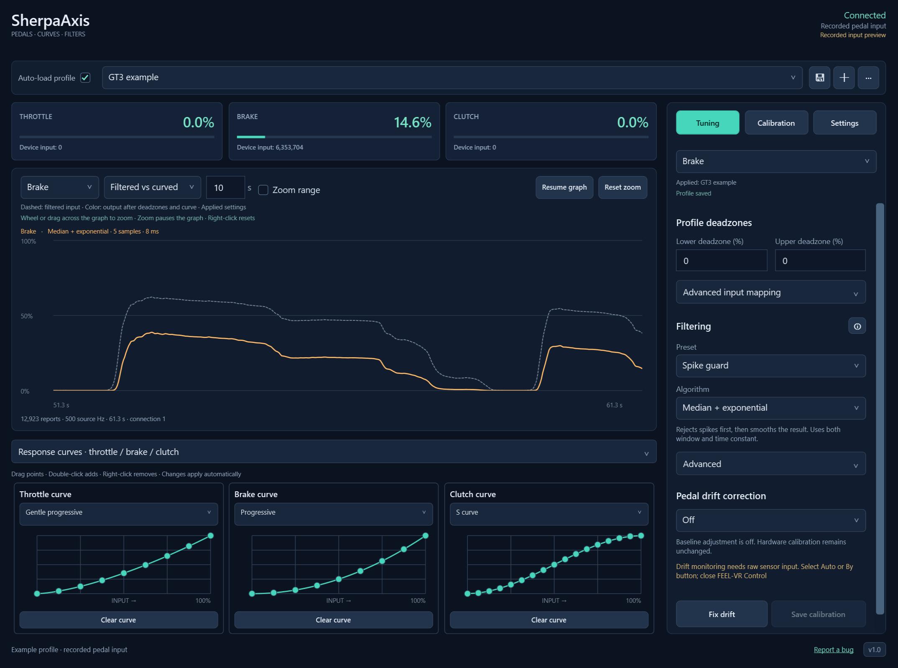
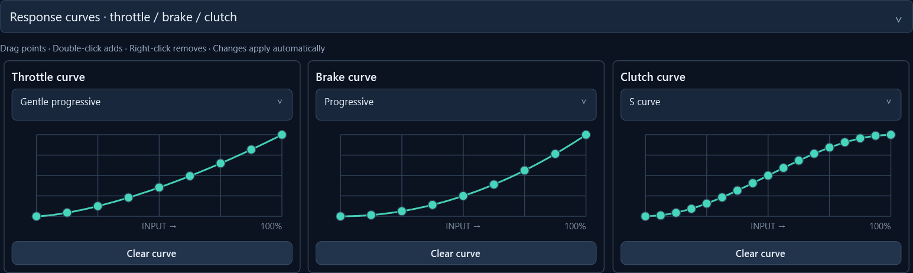
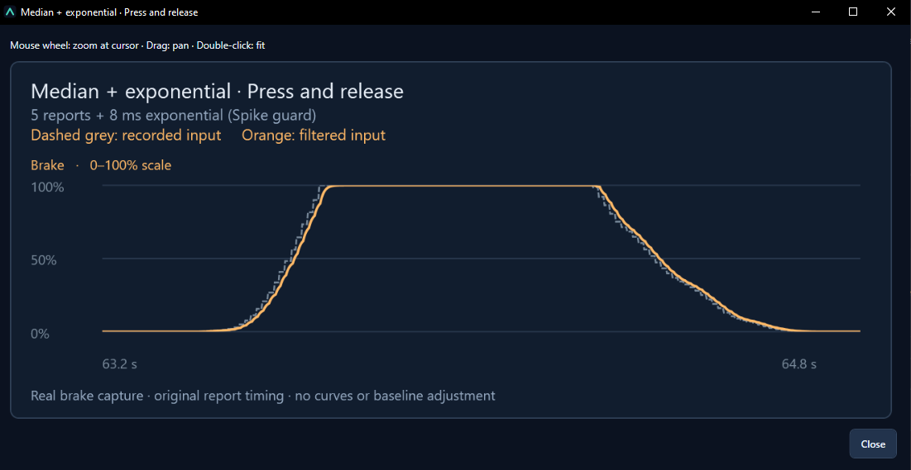
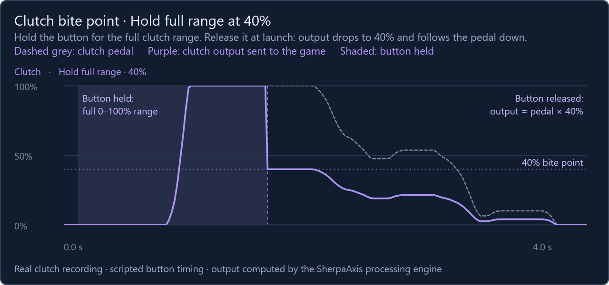

# SherpaAxis

**Tune how your FEEL-VR pedals feel in the game.**

Adjust pedal response, smooth sensor noise and manage calibration from one Windows app.

[**Download Setup.exe**](https://github.com/jaksdhflkjahsdfkjahsdfkjh/SherpaAxis/releases/latest/download/Setup.exe) · [All releases](https://github.com/jaksdhflkjahsdfkjahsdfkjh/SherpaAxis/releases) · [Report a bug](https://github.com/jaksdhflkjahsdfkjahsdfkjh/SherpaAxis/issues)

Windows 10 / 11 · x64 · FEEL-VR Pedals One · English & Ukrainian

*An example profile with recorded pedal input and a Progressive brake curve.
Dashed grey is filtered input; orange is the output after the curve. The pedal
card and the right edge of the graph show the same recorded moment.*

## Your pedals, your response

Make the first part of the throttle easier to control, change how quickly the brake
builds up, or adjust the clutch response. Throttle, brake and clutch each have their
own curve, deadzones and filtering settings.

| What you want to do | How SherpaAxis helps |
| --- | --- |
| Change the feel of a pedal | Choose a response preset or shape the curve yourself. |
| Reduce small input fluctuations | Try a filter and compare the result on the graph. |
| Set up repeatable clutch launches | Bind one button to enable and hold your clutch bite point. |
| Correct a changed resting value | Check for sensor drift and shift the calibrated range. |
| Keep different setups ready | Save profiles for different cars or games and switch from the app or tray. |
| Manage the controller | Calibrate the pedals, back up settings and update supported firmware. |

### Shape each pedal's response

Start with a preset, then drag points to adjust it. Double-click to add a point;
right-click to remove one. Changes apply automatically, so you can watch the output
as you tune. Save the profile when you want to keep your changes.

*Three example curves: Gentle progressive throttle, Progressive brake and S curve clutch.
The brake curve maps 50% input to 25% output, giving more input travel to control the lower output range.*

### See what filtering changes

Filtering can smooth sensor noise and reject short spikes. Use the live graph to
compare the original input, filtered signal and final output. Pause the graph and
zoom with the mouse to inspect small differences.

*A real brake recording: dashed grey is the original input; orange is the filtered
signal. This example uses a five-report median window followed by 8 ms exponential
smoothing. Filtering also adds delay, so compare the result before choosing stronger settings.*

The filtering guide inside the app includes two recorded examples for each filter.
Open it with the information button next to **Filtering**.

### Launch with a clutch bite point

Use a wheel button or keyboard key to control a repeatable clutch position at the
start of a race. One binding handles both switching the assist on and off and
holding it during a launch.

In **Tuning → Clutch**, choose a **Bite point mode**, set **Bite point output (%)**
and click **Bind** to assign your button. Double-tap the button to enable or
disable the assist, or use the **Enabled** checkbox. Hold it for at least **250 ms**
to activate the selected mode's held behavior; releasing applies its released
behavior immediately.

| Mode | While holding the button | After releasing the button |
| --- | --- | --- |
| **Hold bite point** | Keeps clutch output at least at your chosen percentage. Pressing the pedal farther takes priority. | Returns to normal pedal control. |
| **Hold full range** | Gives normal pedal output across the full 0–100% range. | Scales pedal output by your chosen percentage. |

With **Hold full range** set to **40%**, a fully pressed clutch gives **100% output
while held** and **40% after release**. You can then ease off the pedal to bring
output smoothly from 40% down to zero. Half of the normal clutch output becomes
20%; a fully released pedal still gives 0%.

*A real clutch press with Hold full range at 40%: dashed grey is the pedal; purple
is the clutch output sent to the game. While the button is held (shaded), output
reaches 100%. Releasing it drops output to 40%, and easing off the pedal brings it
down to zero.*

Save your profile to keep the mode, percentage and binding. The assist starts
disabled each time you open SherpaAxis. It changes only the processed clutch
output: throttle, brake and hardware calibration stay unchanged, and your game's
axis binding stays the same.

### Correct pedal drift

If a pedal's resting sensor value changes over time, **Pedal drift correction** can
shift both calibration endpoints together while preserving the range and deadzones.

- **Auto** waits for five consistent press-and-release cycles before correcting downward drift.
- **By button** checks for a stable release while you hold a keyboard key or wheel/gamepad button.
- **Fix drift** provides the same manual check directly in the app. Keep your foot off and hold it for at least one stable second, until correction finishes.

First calibrate the affected pedal in SherpaAxis so the app can retain its original
raw range. If the checks disagree, no new correction is applied. Keep your foot
completely off for manual checks: steady foot pressure can also look stable.
Corrections last for the current session unless you choose **Save calibration**.
The original hardware calibration is backed up before a corrected calibration is saved.

### Save a setup for each car or game

Create profiles, give them names and switch between them from the app or system tray.
Enable **Auto-load** on the profile you want at startup; only one profile can have it
enabled. Tuning changes apply immediately, and the saved/unsaved indicator tells you
whether they are stored in your profile.

## Get started

You need **Windows 10 22H2 or Windows 11 on an x64 Intel/AMD PC** and **FEEL-VR Pedals One**.
Native hardware calibration supports the **PE0 controller with firmware 017**;
support for other FEEL-VR models or controller revisions is not established.

1. [Download **Setup.exe** from the latest release](https://github.com/jaksdhflkjahsdfkjahsdfkjh/SherpaAxis/releases/latest/download/Setup.exe).
2. Close **FEEL-VR Control**, including its tray instance, games and other vJoy feeders.
3. Run Setup, allow the administrator prompt and follow the wizard. Restart Windows if requested.
4. Connect the pedals and open **SherpaAxis** from the Start menu. Input and virtual output start automatically.
5. Follow the interactive first-launch tour, then bind the selected virtual pedal device in your game's controls.

| Game control | Virtual axis |
| --- | --- |
| Throttle | X |
| Brake | Y |
| Clutch | Z |

Setup is a single offline installer. It includes the .NET runtime, vJoy, HidHide,
the ST DfuSe firmware tool and its USB driver. You do not need developer tools or
scripts. Existing vJoy device configurations are preserved.

You can also use **SherpaAxis-win-x64.zip**. Extract the archive into a permanent
location, open the resulting **SherpaAxis** folder and run **SherpaAxis.App.exe**.
"Extract here" keeps all app files together in that folder. Choose English or
Ukrainian before first-run setup installs missing drivers from the bundled files
and configures the virtual pedals. The chosen language is also used by the app.
Approve the Windows administrator prompt and restart Windows if requested, then
open the app again. No separate driver downloads or manual DLL selection are needed.
**START-HERE.txt** includes setup and troubleshooting instructions.

To uninstall, use **Windows Settings → Apps** for a Setup installation, or exit
SherpaAxis and run **Uninstall.exe** inside an extracted ZIP folder, then choose
English or Ukrainian. Drivers are
kept by default. You can also remove recorded, unchanged drivers installed by
SherpaAxis; drivers that were already present are preserved. Profiles, settings
and calibration backups are kept. Driver ownership tracking starts with v1.2.1;
older installations without records keep their drivers.

**Keep SherpaAxis running while playing.** The app sends processed pedal input to
your game. Minimizing it or leaving it in the system tray continues output;
choosing **Exit** stops output. Keep FEEL-VR Control closed while using SherpaAxis.

The release also includes `SHA256SUMS.txt`. To check your download, run
`Get-FileHash .\Setup.exe -Algorithm SHA256` in PowerShell and compare the result
with that file.

## Help and common questions

Replay the tour from **Settings → Help → Getting started**, or open **Setup guide**
there for device and game setup instructions.

<strong>Which controller should I bind in the game?</strong>

Use the dedicated virtual pedal device selected by SherpaAxis. When it is the only
configured vJoy device, Windows Game Controllers shows **FEEL-VR Pedals One
(SherpaAxis)**. Some games may still call it **vJoy**. If you have other vJoy slots,
the shared name stays unchanged. SherpaAxis remembers its virtual device to keep
your bindings consistent.

**Hide physical pedals from games** is enabled by default to help prevent duplicate
input. Remove old game bindings to the physical pedals. Their Windows HID driver
must stay installed so SherpaAxis can read them. If a game still sees both devices,
close the game and reconnect the pedals. Existing HidHide configurations may need
review; follow any status shown in Settings.

<strong>What if virtual output is unavailable?</strong>

Close other vJoy feeders, open **Settings** and run **Automatic vJoy setup**.
Restart Windows if requested. An incompatible existing driver may need repair;
Setup preserves it rather than replacing it silently.

See the [installation and device guide](docs/setup.md) for more detail.

<strong>Can I back up calibration and update pedal firmware?</strong>

Use **Calibration → Device tools** for hardware calibration backups and restoration.
In **Settings → Firmware update**, you can check firmware, back up calibration,
open update logs or update the supported firmware.

Choose **Update firmware**, select a bundled image and click **Flash**. Keep the
pedals connected. SherpaAxis waits for them to restart, restores and saves the
original calibration if needed, then checks the controller, USB port, firmware and
calibration. Click **OK** when it finishes. If a step fails, output stays paused
and the backup and logs remain available for recovery.

Firmware byte readback is not performed. Setup prepares the tools and USB driver;
it does not flash the pedals during installation. Read the [firmware guide](docs/firmware.md)
for compatibility and recovery details.

<strong>How do updates and uninstalling work?</strong>

SherpaAxis checks for a newer stable GitHub release once at each app startup.
An update link appears in the footer, with a tray notification when the app is
hidden. **Settings → Updates** offers **Check now** and an option to disable startup
checks. No pedal data or profiles are sent. Downloads and installation are manual.

To update, download the newer `Setup.exe`, exit SherpaAxis from its tray menu,
close FEEL-VR Control and games, then run Setup. Your profiles and settings are retained.

To uninstall, use Windows **Settings → Apps → SherpaAxis → Uninstall**. Profiles
and settings are retained. The shared vJoy and HidHide drivers stay installed;
SherpaAxis releases its own visibility entries and restores the previous controller
display name. After an abnormal termination, reopen the app and exit normally to
complete visibility cleanup.

## Found a problem?

[Open a GitHub issue](https://github.com/jaksdhflkjahsdfkjahsdfkjh/SherpaAxis/issues)
with your app version, Windows version, pedal firmware and the steps to reproduce
the problem. Include what you expected and what happened instead.
**Settings → Export diagnostic report** creates a ZIP you can review and attach.

## License

SherpaAxis is licensed under the [MIT License](LICENSE).
Bundled ST DfuSe components retain their [ST license](vendor/dfuse/SLA0044.txt).
